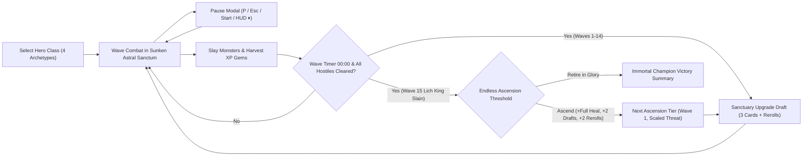
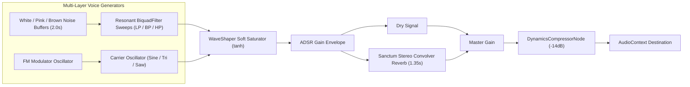

# Game Design Document: **Arcane Arena**

## 1. Executive Summary
**Arcane Arena** is a fast-paced, top-down dark-fantasy twin-stick arena survival roguelite built to run natively in modern web browsers at 60 FPS with zero external dependencies. Players select from **4 distinct fantasy hero classes**—each featuring bespoke top-down SVG sprites, directional weapon/spell animations, unique movement dashes, and signature active skills—to battle escalating waves of monsters inside **The Sunken Astral Sanctum**.

Slaying monsters yields physical Experience Gems (XP) that fuel between-wave Sanctuary upgrade drafts. Upon conquering Wave 15 and defeating **The Lich King**, players can enter the **Endless Ascension System**, carrying their Hero Level, Attributes, and Upgrades into **Ascension II: Blood Moon (Wave 1)** and beyond (*Ascension III, IV, V...*), where monster vitality, damage, speed, spawn cadence, and XP bounties scale holistically without limit.

> [!NOTE]
> **Target Platform & Tech Stack**: Single-file HTML5 Canvas 2D ([index.html](file:///home/antigravity/arcane-arena/index.html)) + Modular SVG Vector Assets (`32` total `.svg` files in `assets/`) + Multi-Layered Web Audio API DSP Synthesizer. Instant 60 FPS execution across Desktop and Mobile (Android/iOS) with adaptive viewport scaling (`--ui-scale`, `--touch-scale`, `camera.zoom`), real-time hardware input presence detection, and seamless hot-swapping across `WASD + Arrow Keys`, `WASD + Mouse`, `Gamepad API` controllers, and `Multi-Touch Virtual Twin-Sticks`.

---

## 2. Core Gameplay & Endless Ascension Loop



1. **Choose Your Hero**: Select from **Warrior**, **Archer**, **Wizard**, or **Rogue** on the class selection screen.
2. **Survive & Clear Each Wave**: Navigate the `2000×1400` **Sunken Astral Sanctum** around 4 Runic Obelisk pillars while enemies emerge from telegraphing summoning rifts (`1.15s` warning indicator).
   - **No Early Wave Cutoff**: When the wave countdown reaches `00:00`, new portal spawning stops and the HUD displays `CLEAR (X)` until all remaining monsters on the battlefield are slain.
   - **Zero Dead Air**: If all active monsters and portals are wiped out while time remains on the clock (`> 1.5s`), the next portal batch fast-forwards (`0.25s`) to keep combat brisk.
3. **Harvest XP & Build Combos**: Monsters drop physical XP crystals (`Green`, `Blue`, `Purple`, and `Gold Boss Cores`). Rapidly collecting gems increments an **XP Combo** that climbs a musical 12-note **D-Dorian Crystal Harp** scale.
4. **Sanctuary Upgrade Draft**: Between waves, remaining XP gems auto-magnetize (`85%` value), `25%` missing HP is restored, Arcane Barrier recharges, and players draft from **3 randomized Upgrade Cards** (with free Rerolls earned every 3 waves).
5. **Endless Ascension (`Wave 15+`)**: Defeating the Lich King on Wave 15 opens the **Ascension Threshold Modal**, allowing the player to ascend into **Ascension II: Blood Moon — Wave 1** (and infinitely higher tiers) with full character persistence and holistic difficulty scaling.

---

## 3. Controls, Hardware Input Detection, Touch Twin-Stick, Pause & Viewport Scaling Architecture

The [`InputManager`](file:///home/antigravity/arcane-arena/index.html#L1872-L2932) normalizes movement and aim vectors `(dx, dy)` across Keyboard, Mouse, Gamepad, and Multi-Touch screens, with real-time hardware presence detection, automatic Touch-Screen fallback when no physical input exists, and a dedicated **Input & Gamepad Setup Modal**.

### 3.1 Input Mapping Matrix

| Action | Keyboard Only (Twin-Key) | Keyboard + Mouse (Hybrid) | Gamepad (XInput / DualSense / DirectInput) | Touch-Screen (Virtual Twin-Stick HUD) |
| :--- | :--- | :--- | :--- | :--- |
| **Move Vector** | `W` `A` `S` `D` (or `Arrow Keys` when toggled) | `W` `A` `S` `D` | **Left Stick** (Axes `[0,1]` with auto-fallback), **D-Pad** (`buttons[12..15]`), or **POV Hat** (`axis[9]`) | **Left Virtual Analog Stick** (`#touchLeftZone`, independent `Touch.identifier` tracking) |
| **Aim Vector & Auto-Fire** | `↑` `↓` `←` `→` Arrow Keys (`±13°` Smart Aim Cone) | Mouse Cursor + `Left Click` (or Auto-Aim toggle) | **Right Stick** (`±9°` Smart Aim Cone; deflecting past deadzone aims & fires) | **Right Virtual Analog Stick** (`#touchRightZone`, `±9°` Smart Aim Cone & auto-fire) |
| **Manual Fire Override** | Hold `Arrow Keys` | Hold `Left Click` | `RT` / `R2` (`buttons[7]`) or `RB` / `R1` (`buttons[5]`) | Hold **Right Virtual Stick** |
| **Dash / Evade** | `Space` | `Space` | `LB` / `L1` (`buttons[4]`) or `A` / `Cross` (`buttons[0]`) | **Touch DASH Button** (`#touchBtnDash` with live cooldown readout) |
| **Signature Class Skill** | `Left Shift` or `E` | `Right Click`, `Shift`, or `E` | `LT` / `L2` (`buttons[6]`) or `X` / `Square` (`buttons[2]`) | **Touch SKILL Button** (`#touchBtnSkill` with live cooldown readout) |
| **Pause / Resume** | `P` or `Escape` | `P`, `Escape`, or HUD **⏸ PAUSE** Button | `Start` / `Options` (`buttons[9]`) | Top/Bottom HUD **⏸ PAUSE** Button (`#btnPauseTop` / `#btnPauseBottom`) |
| **Swap L/R Sticks** | HUD / Modal Button | HUD / Modal Button | `Select` / `Back` (`buttons[8]`) | HUD / Modal Button |
| **Menu Navigation** | `1`–`4` or `←`/`→` + `Enter`/`Space` | Point & Click | **Left Stick** / **D-Pad** + `A` (Confirm) / `X` (Reroll) | Direct Tap on Class / Upgrade Cards |

### 3.2 Hardware Input Presence Detection & Adaptive Touch-Screen Fallback
- **Two-Tier Hardware Presence Detection (`detectInitialHardwarePresence()`)**:
  - **Mouse (`hardware.mouse`)**: Queries `window.matchMedia('(any-pointer: fine) and (any-hover: hover)')` vs `(pointer: coarse) and (hover: none)` on startup, and promotes to `'verified'` upon physical `pointermove`/`pointerdown` (`pointerType === 'mouse'`).
  - **Physical Keyboard (`hardware.keyboard`)**: Combines a desktop pointer/hover + User-Agent heuristic (`'inferred'`) with instant live promotion to `'verified'` upon any physical `keydown` event.
  - **Gamepad (`hardware.gamepad`)**: Queries `navigator.getGamepads()` and listens to `gamepadconnected` / `gamepaddisconnected` events.
  - **Touchscreen (`hardware.touch`)**: Queries `navigator.maxTouchPoints > 0`, `'ontouchstart' in window`, and `(pointer: coarse)`, promoting to `'verified'` on `touchstart`.
- **Automatic Touch HUD Activation (`touchHudMode: 'auto' | 'on' | 'off'`)**:
  - In `AUTO` mode, if **no physical input exists** (`keyboard === 'none' && mouse === 'none' && gamepad === 'none'`) or as soon as the player touches the screen (`pointerType === 'touch'`), `#touchControlsOverlay` automatically activates during combat.
  - Pressing a physical key, clicking/moving a physical mouse, or deflecting a gamepad stick automatically hides the touch overlay in `AUTO` mode so desktop/controller players have an unobstructed arena view.
  - Players on hybrid devices (or desktop testers) can cycle `Touch HUD: AUTO / ON / OFF` at any time from the Title Screen, Combat Quick Controls Drawer, or Input Setup Modal.

### 3.3 Advanced Gamepad Compatibility & Calibration Features
- **Multi-Gamepad Active Scanning**: Scans all entries in `navigator.getGamepads()` and automatically locks onto whichever controller exhibits active stick deflection or button presses (ignoring virtual/ghost gamepads at `index 0`).
- **Resting `-1.0` Trigger Baseline Masking**: Automatically masks analog triggers (L2/R2 on Linux/Firefox/DirectInput) that rest at `-1.0` so they are never misidentified as stick deflection.
- **Automatic Stick Fallback & Natural Movement Facing**:
  - If a controller maps its physical Left Stick to non-standard axes and `[0, 1]` has never moved, the engine falls back so the hero is never stuck immobile.
  - When moving with the Left Stick/D-Pad while the Right Stick is centered, the hero naturally faces their movement direction (`RT`/`RB` fires forward).
- **Interactive 2-Step Stick Calibration Wizard**: Accessible anytime from the Title Screen, Pause Menu, or Combat HUD (`Input & Gamepad Setup`), displaying live hardware presence status, raw axis bars (`a0`–`a9`), visual Left/Right stick radar scopes, a 1-click **Swap Left & Right Sticks** toggle, and a 2-step calibration wizard that binds custom axis pairs to Move and Aim.

### 3.4 Responsive Viewport Scaling & Non-Obstructive Mobile HUD Architecture
To ensure informational overlays and touch controls remain clear and unobtrusive on Android phones, tablets, and desktop monitors (in both portrait and landscape orientations), [`updateViewportScale()`](file:///home/antigravity/arcane-arena/index.html#L3033-L3084) dynamically computes CSS and canvas scaling factors on `resize`, `orientationchange`, and `visualViewport` events:
- **CSS Transform Viewport Scaling (`--ui-scale` & `--touch-scale`)**:
  - Computes `--ui-scale` (`0.56`–`1.15`) from the viewport's width and height (`Math.min(vw / 1080, vh / 640)` on mobile/compact screens) and applies `width: calc(100% / var(--ui-scale)); transform: scale(var(--ui-scale));` to the top and bottom HUD bars (`.hud-scaled-bar-top`, `.hud-scaled-bar-bottom`) alongside safe-area insets (`env(safe-area-inset-*)`).
  - Players can also manually cycle **UI Scale Presets** (`AUTO`, `COMPACT`, `NORMAL`, `LARGE`) via [`cycleUiScaleMode()`](file:///home/antigravity/arcane-arena/index.html#L3086-L3092) from the Title Screen, Combat Quick Controls Drawer, Pause Menu, or Input Setup Modal.
  - Dynamically scales virtual twin-stick zones (`--stick-zone-size`, `--stick-base-size`, `--stick-nub-size`, `--touch-btn-size`) via `--touch-scale` (`0.60`–`1.0`) and updates `stick.maxRadius` from the rendered bounding box so sticks never overlap on narrow portrait (`360px` wide) or short landscape (`360px` tall) phones.
- **Single-Row Non-Wrapping Top HUD (`#hudOverlay`)**:
  - Packs **Vitality + Arcane Shield**, **Ascension Wave Clock + Kills + ⚙️ Quick Controls + ⏸ Pause**, and **Level + XP Progress + Mini Stat Pills (`DMG`, `SPD`, `CRIT`, `ARM`)** into a single horizontal `flex-nowrap` strip (`~32–42px` visual height on mobile, `< 9%` of vertical screen height).
- **Zero-Duplicate Bottom HUD & Collapsible Quick Controls Drawer (`#hudBottomOverlay`)**:
  - Automatically hides the bottom Dash/Skill ability cards (`#hudAbilityCardsRow`) whenever the Touch Twin-Stick HUD is active (since `#touchBtnDash` and `#touchBtnSkill` already display live ability cooldowns right above the right thumbstick).
  - Moves secondary configuration buttons and input telemetry (`UI Scale`, `Touch HUD`, `Swap L/R Sticks`, `Arrows Mode`, `Mouse Aim`, `SFX`, `Input Setup`) into a collapsible **Quick Controls Drawer (`#hudControlsDrawer`)** toggled via the top-bar `⚙️` button.
- **Adaptive World Camera Zoom (`camera.zoom`)**:
  - Automatically scales the 2D canvas world camera (`camera.zoom = clamp(min(vw / 980, vh / 600), 0.56, 1.0)`) on mobile screens so players always see a full tactical field-of-view (`≥ 980×600` world units) rather than a cramped crop around the hero.

### 3.5 Pause & Resume System (`PAUSED` State & Sanctum Pause Modal)
Players can pause and resume combat at any moment via [`pauseGame()`](file:///home/antigravity/arcane-arena/index.html#L6133-L6165) and [`resumeGame()`](file:///home/antigravity/arcane-arena/index.html#L6167-L6180):
- **Universal Triggers**: Keyboard `P` or `Escape`, Gamepad `Start` / `Options` (`buttons[9]`), the always-accessible Top HUD **`⏸` button (`#btnPauseTop`)**, or the Bottom Drawer **`⏸ Pause` button (`#btnPauseBottom`)**.
- **Clean Simulation Freeze**: Entering `gameState = 'PAUSED'` freezes all monster AI, projectiles, wave timers, and cooldown ticks, resets active touch sticks, and temporarily hides `#touchControlsOverlay` so modal buttons are unobstructed. Resuming resets `lastTime = performance.now()` to prevent any delta-time jump.
- **Sanctum Paused Modal (`#screenPause`)**: Displays a live **Current Run Summary** (Hero Class & Level, Ascension Tier & Wave Clock, Vitality/Shield, Attack Power, Attack Speed, Crit Chance/Mult, Armor/Speed, Monsters Slain, Total Damage Dealt) alongside quick actions to **Resume Combat**, open **Input / Touch / Gamepad Setup**, toggle **UI Scale** or **SFX Mute**, **Restart Run**, or **Change Hero Class**.

---

## 4. Playable Hero Classes & Base Attribute Profiles

| Attribute | **Warrior** (*Iron Vanguard*) | **Archer** (*Sylvan Ranger*) | **Wizard** (*Arcane Weaver*) | **Rogue** (*Shadowblade*) |
| :--- | :--- | :--- | :--- | :--- |
| **Role** | Melee Cleave & Crowd Control | Long-Range Pierce & Mobility | Elemental AoE & Chain Magic | Hybrid Kunai & Backstab Assassin |
| **Max HP (`maxHp`)** | `150 HP` | `95 HP` | `80 HP` | `90 HP` |
| **Arcane Barrier (`maxBarrier`)** | `0` | `0` | `30 Shield` (`5.5/s` regen after `3.5s`) | `0` |
| **Armor (`armor`)** | `15%` Damage Reduction | `0%` | `0%` | `5%` Damage Reduction |
| **Move Speed (`speed`)** | `225 px/s` | `270 px/s` | `210 px/s` | `295 px/s` |
| **Base Damage (`damage`)** | `28` | `20` | `24` | `16` |
| **Attack Cooldown** | `0.38s` (`2.63/s`) | `0.24s` (`4.17/s`) | `0.34s` (`2.94/s`) | `0.19s` (`5.26/s`) |
| **Base Crit Chance** | `10%` (`1.75x` Crit Mult) | `18%` (`1.75x` Crit Mult) | `12%` (`1.75x` Crit Mult) | `26%` (`1.75x` Crit Mult) |
| **Primary Attack** | **Crescent Cleave**: `135°` broadsword sweep. Every 3rd strike unleashes a `180°` cleave + piercing **Golden Shockwave**. | **Quickdraw Bow**: High-velocity arrows. Every 4th arrow is a **Perfect Draw** (`100%` Guaranteed Crit, `+45%` DMG, `3` Pierce). | **Elemental Staff**: Cycles **Fireball** (burning puddle), **Frostbolt** (`45%` AoE slow), and **Lightning Orb** (`2`-target chain). | **Phantom Blades**: Throws piercing kunai + executes a `145%` guaranteed-crit **Twin-Dagger Backstab** against enemies within melee range (`78px`). |
| **Dash Ability** | **Shield Bash** (`3.0s` CD): Charge through enemies, dealing `80%` damage and stunning them for `1.25s`. | **Acrobatic Vault** (`2.3s` CD): Tumble away and drop 3 **Caltrop** fields that slow and damage pursuers for `4.5s`. | **Arcane Blink** (`3.2s` CD): Teleport `210px` instantly, leaving an **Arcane Decoy** that taunts monsters and explodes after `0.9s`. | **Shadow Step** (`2.2s` CD): Phase through enemies, applying a **Death Mark** that detonates for `220%` crit damage after `1.1s`. |
| **Signature Skill** | **Whirlwind** (`7.5s` CD): Spin blades for `2.5s`, pulling monsters inward, slicing continuously, and deflecting enemy projectiles. | **Volley of Thorns** (`6.5s` CD): Fire a 7-arrow cone barrage (`135%` DMG, `4` Pierce) that inflicts **Poison DoT** and **Slow**. | **Singularity** (`9.0s` CD): Conjure a gravity vortex at `230px` that drags monsters inward and pulses AoE damage for `2.6s`. | **Smoke Shroud** (`6.5s` CD): Vanish into **Stealth** for `2.6s` (enemies lose target, `+25%` speed, `+50%` DMG, `+35%` Crit) and fire an 8-kunai ring. |

---

## 5. Primary Player Attributes & Sanctuary Upgrade Matrix

### 5.1 Complete Attribute Scaling & Soft Caps / Over-Crit Rules
To support infinite progression in **Endless Ascension** without breaking physics or allowing 100% damage immunity, attributes follow structured scaling rules:

| Attribute Key | Description | Endless Scaling Rule / Cap / Floor |
| :--- | :--- | :--- |
| `damage` & `damageMult` | Base weapon/skill damage × global multiplier (`1.0` base). | **Uncapped** — scales infinitely to match Ascension monster HP. |
| `attackSpeedMult` | Divides primary attack cooldown (`attackCooldown / attackSpeedMult`). | **Uncapped** — continuously increases fire/swing rate. |
| `critChance` & `critMult` | Probability of a Critical Strike (`1.75x` base multiplier). | **Over-Crit Conversion**: Any `critChance` above `100%` (`1.0`) automatically converts **1:2 into bonus `critMult`** (e.g., `+10%` excess Crit Chance grants `+0.20x` Crit Damage). |
| `maxHp` & `hp` | Maximum and current health pool (`25%` missing HP healed after each wave). | **Uncapped**. |
| `maxBarrier` | Regenerating Arcane Shield (`5.5/s` after `3.5s` out of combat) that absorbs damage before HP. | **Uncapped**. |
| `armor` | Flat percentage reduction applied to incoming hits before Barrier/HP. | **Soft-Capped at `75%` (`0.75`)** so enemies always pose a threat on high Ascensions. |
| `speed` | Movement velocity in `px/s` (`+25%` during Rogue Stealth). | **Capped at `460 px/s`** so arena navigation remains controllable. |
| `dashCd` & `skillCd` | Cooldowns for Dash and Signature Class Skill. | **Floored at `0.65s` (`dashCd`) and `1.80s` (`skillCd`)** to prevent infinite invulnerability frames. |
| `extraProjectiles` & `bonusPierce` | Additional projectiles per volley and additional enemies pierced per projectile. | **Uncapped**. |
| `meleeRangeMult` & `aoeMult` | Multipliers for melee slash/Whirlwind radius and spell/hazard AoE radius. | **Uncapped**. |
| `vampOnHit`, `chainOnCrit`, `executeThreshold` | Lifesteal per melee cleave (`up to 8 HP/swing`), Chain Lightning jumps on Crit, and instant-kill threshold on non-bosses. | `executeThreshold` capped at `30%` max HP. |

### 5.2 Complete 18-Card Sanctuary Upgrade Pool ([`UPGRADE_POOL`](file:///home/antigravity/arcane-arena/index.html#L1683-L1862))

| Upgrade Name | Rarity | Eligible Classes | Mechanical Effect |
| :--- | :--- | :--- | :--- |
| **Runed Weaponry** | Common | All Classes | `+22%` Primary & Skill Damage (`damageMult += 0.22`). |
| **Alacrity Gloves** | Common | All Classes | `+18%` Attack & Cast Speed (`attackSpeedMult += 0.18`). |
| **Windstrider Boots** | Common | All Classes | `+14%` Move Speed (`speed * 1.14`, max `460`) & `-10%` Dash Cooldown (`min 0.65s`). |
| **Vitality Heartstone** | Common | All Classes | `+35` Max HP and heal `40 HP` immediately. |
| **Ironclad Bulwark** | Rare | All Classes | `+10%` Armor Damage Reduction (`max 75%`) & `+20` Max HP. |
| **Eagle Eye Charm** | Rare | All Classes | `+12%` Crit Chance (excess `>100%` converts `1:2` to Crit DMG) & `+25%` Crit Multiplier. |
| **Arcane Aegis** | Rare | All Classes | Gain `+30` Regenerating Arcane Barrier (`+2.0/s` recharge rate). |
| **Astral Lodestone** | Common | All Classes | `+45%` XP Gem Pickup Radius & `+18%` XP Gain (`xpMult += 0.18`). |
| **Chronos Hourglass** | Epic | All Classes | `-20%` Signature Skill Cooldown (`min 1.8s`) & `-15%` Dash Cooldown (`min 0.65s`). |
| **Stormcaller's Signet** | Epic | All Classes | Critical Hits unleash Chain Lightning jumping to `+2` nearby enemies for `55%` damage. |
| **Vampiric Broadsword** | Rare | **Warrior** | Cleaving enemies restores `+2 HP` per monster hit (up to `8 HP` per swing) & `+15%` Damage. |
| **Titan's Greatsword** | Epic | **Warrior** | `+30%` Cleave & Whirlwind Radius (`meleeRangeMult += 0.30`); **every** slash fires a Golden Shockwave. |
| **Split-Shot Quiver** | Epic | **Archer** | Fires `+2` additional arrows per volley in a spread cone. |
| **Serpent's Fang Shafts** | Rare | **Archer** | Arrows pierce `+2` additional enemies and apply venomous **Poison DoT** (`3.5s`). |
| **Archmage's Prism** | Epic | **Wizard** | Casts `+1` additional Elemental Orb per attack & `+35%` Explosion/Singularity AoE Radius. |
| **Superconduct Conduit** | Rare | **Wizard** | `+28%` Spell Damage & `-22%` Singularity and Arcane Blink cooldowns. |
| **Shadow Fan Mastery** | Epic | **Rogue** | Throws `+2` additional Kunai per attack & `+1` Pierce. |
| **Assassin's Execution** | Legendary | **Rogue** | `+35%` Crit Damage & instantly executes non-boss monsters below `18%` HP (`up to 30%`). |

---

## 6. Enemy Roster, Bosses & Holistic Endless Ascension Scaling

### 6.1 Monster & Boss Roster ([`createEnemy`](file:///home/antigravity/arcane-arena/index.html#L4116-L4218) & [`spawnBossForWave`](file:///home/antigravity/arcane-arena/index.html#L4220-L4250))
| Monster / Boss | SVG Sprite | Base HP | Base Speed | Base DMG | Base XP | AI Behavior & Mechanics |
| :--- | :--- | :--- | :--- | :--- | :--- | :--- |
| **Goblin Scavenger** | [goblin.svg](file:///home/antigravity/arcane-arena/assets/goblin.svg) | `32` | `145–190` | `10` | `2` | Fast pack swarmer with crudely notched cleaver. |
| **Slime Splitter** | [slime.svg](file:///home/antigravity/arcane-arena/assets/slime.svg) | `58` | `98` | `13` | `4` | Gelatinous tank; splits into **2 Mini-Slimes** (`22 HP`, `155 Spd`) upon death. |
| **Skeleton Archer** | [skeleton_archer.svg](file:///home/antigravity/arcane-arena/assets/skeleton_archer.svg) | `40` | `105` | `14` | `5` | Kites at `180–290px`; telegraphs a red laser sight for `0.75s` before firing a `430 px/s` bone arrow. |
| **Wraith Charger** | [wraith.svg](file:///home/antigravity/arcane-arena/assets/wraith.svg) | `52` | `125` | `16` | `6` | Phases through pillars; winds up for `0.55s` with a telegraph line, then lunges at `520 px/s`. |
| **Necromancer Cultist** | [necromancer.svg](file:///home/antigravity/arcane-arena/assets/necromancer.svg) | `72` | `88` | `14` | `10` | Stands back at `360px` and summons new Goblin portals every `4.2s` (faster on higher Ascensions). |
| **Golem Juggernaut** | [golem.svg](file:///home/antigravity/arcane-arena/assets/golem.svg) | `145` | `74` | `22` | `14` | Heavy obsidian colossus; immune to knockback and deals crushing contact damage. |
| **Wave 5 Boss: The Iron Minotaur** | [boss_minotaur.svg](file:///home/antigravity/arcane-arena/assets/boss_minotaur.svg) | `620` | `125` | `18` | `80` | Relentless arena juggernaut that unleashes radial 6+ projectile shockwave barrages. |
| **Wave 10 Boss: Arachne Broodmother** | [boss_arachne.svg](file:///home/antigravity/arcane-arena/assets/boss_arachne.svg) | `900` | `135` | `20` | `140` | Fast chitinous horror firing dense 10+ projectile radial poison barrages. |
| **Wave 15 Boss: The Lich King** | [boss_lich.svg](file:///home/antigravity/arcane-arena/assets/boss_lich.svg) | `1120` | `140` | `22` | `250` | Undead arch-monarch commanding high-density bullet-hell rings and necrotic summons. |

### 6.2 Endless Ascension Scaling Formula ([`ASCENSION_CONFIG`](file:///home/antigravity/arcane-arena/index.html#L2938-L3004))
When the player defeats the Lich King on Wave 15 and chooses to **Ascend**, `wave.ascension` increments (`A = 1, 2, 3, 4...`) and `wave.number` resets to `Wave 1`. To guarantee that **Ascension $A+1$, Wave 1** is immediately more challenging than **Ascension $A$, Wave 15** while honoring the `1x → 2x → 3x → 4x` tier multiplier, [`getAscensionScaling(A, w)`](file:///home/antigravity/arcane-arena/index.html#L2973-L3004) computes:

$$\text{TierMultiplier}(A) = 1 + (A - 1) \times 1.0 \quad (\text{i.e., } 1\times, 2\times, 3\times, 4\times\dots)$$

$$\text{WaveHpCurve}(A, w) = 1 + 0.16(w - 1) + 1.15(A - 1)$$

$$\text{WaveDmgCurve}(A, w) = 1 + 0.08(w - 1) + 0.60(A - 1)$$

$$\text{TotalHpMult}(A, w) = \text{TierMultiplier}(A) \times \text{WaveHpCurve}(A, w)$$

$$\text{TotalDmgMult}(A, w) = \text{TierMultiplier}(A) \times \text{WaveDmgCurve}(A, w)$$

| Ascension Tier | Realm Title & Sanctum Aura | Tier Base (`HP & DMG`) | Wave 1 Effective HP | Wave 15 Effective HP | Speed Bonus | Spawn Cadence | Boss Radial Projectiles | XP Gem Bounty |
| :--- | :--- | :--- | :--- | :--- | :--- | :--- | :--- | :--- |
| **Ascension I** | *Mortal Realm* (Cyan `#38bdf8`) | **`1.0x`** | `1.00x` | `3.24x` | `+0%` | `1.00x` | `6` (W5) / `10` (W10–15) | **`1.0x` XP** |
| **Ascension II** | *Blood Moon* (Crimson `#f43f5e`) | **`2.0x`** | `4.30x` | `8.78x` | `+10%` | `1.15x` faster | `9` (W5) / `13` (W10–15) | **`2.0x` XP** |
| **Ascension III** | *Abyssal Surge* (Violet `#a855f7`) | **`3.0x`** | `9.90x` | `16.62x` | `+20%` | `1.30x` faster | `12` (W5) / `16` (W10–15) | **`3.0x` XP** |
| **Ascension IV** | *Void Cataclysm* (Solar Gold `#f59e0b`) | **`4.0x`** | `17.80x` | `26.76x` | `+30%` | `1.45x` faster | `15` (W5) / `19` (W10–15) | **`4.0x` XP** |
| **Ascension V+** | *Astral Eclipse / Eternal Nightmare* | **`5.0x+`** | `28.00x+` | `39.20x+` | Up to `+60%` | `+15%` / tier | `+3` / tier | **`5.0x+` XP** |

---

## 7. Visual Art Direction & Modular SVG Tiling Architecture

### 7.1 Complete 32-File SVG Vector Asset Inventory (`/home/antigravity/arcane-arena/assets/`)
All characters, monsters, weapons, spells, and environment tiles are authored as lightweight, resolution-independent top-down SVGs:
- **4 Hero Class Sprites**: [warrior.svg](file:///home/antigravity/arcane-arena/assets/warrior.svg), [archer.svg](file:///home/antigravity/arcane-arena/assets/archer.svg), [wizard.svg](file:///home/antigravity/arcane-arena/assets/wizard.svg), [rogue.svg](file:///home/antigravity/arcane-arena/assets/rogue.svg).
- **9 Monster & Boss Sprites**: [goblin.svg](file:///home/antigravity/arcane-arena/assets/goblin.svg), [slime.svg](file:///home/antigravity/arcane-arena/assets/slime.svg), [skeleton_archer.svg](file:///home/antigravity/arcane-arena/assets/skeleton_archer.svg), [wraith.svg](file:///home/antigravity/arcane-arena/assets/wraith.svg), [necromancer.svg](file:///home/antigravity/arcane-arena/assets/necromancer.svg), [golem.svg](file:///home/antigravity/arcane-arena/assets/golem.svg), [boss_minotaur.svg](file:///home/antigravity/arcane-arena/assets/boss_minotaur.svg), [boss_arachne.svg](file:///home/antigravity/arcane-arena/assets/boss_arachne.svg), [boss_lich.svg](file:///home/antigravity/arcane-arena/assets/boss_lich.svg).
- **10 Weapon, Projectile & Spell FX Sprites**: [fx_sword_cleave.svg](file:///home/antigravity/arcane-arena/assets/fx_sword_cleave.svg), [fx_shockwave.svg](file:///home/antigravity/arcane-arena/assets/fx_shockwave.svg), [proj_arrow.svg](file:///home/antigravity/arcane-arena/assets/proj_arrow.svg), [proj_arrow_crit.svg](file:///home/antigravity/arcane-arena/assets/proj_arrow_crit.svg), [proj_kunai.svg](file:///home/antigravity/arcane-arena/assets/proj_kunai.svg), [proj_enemy_arrow.svg](file:///home/antigravity/arcane-arena/assets/proj_enemy_arrow.svg), [spell_fireball.svg](file:///home/antigravity/arcane-arena/assets/spell_fireball.svg), [spell_frostbolt.svg](file:///home/antigravity/arcane-arena/assets/spell_frostbolt.svg), [spell_lightning_orb.svg](file:///home/antigravity/arcane-arena/assets/spell_lightning_orb.svg), [spell_singularity.svg](file:///home/antigravity/arcane-arena/assets/spell_singularity.svg).
- **9 Modular Environment & Tilemap SVGs ("The Sunken Astral Sanctum")**:
  1. [env_tile_stone_a.svg](file:///home/antigravity/arcane-arena/assets/env_tile_stone_a.svg) (`100×100`): Beveled obsidian-slate flagstones with mortar joints and bronze dowels.
  2. [env_tile_stone_b.svg](file:///home/antigravity/arcane-arena/assets/env_tile_stone_b.svg) (`100×100`): Weathered cracked flagstones with bioluminescent teal sanctum moss.
  3. [env_tile_runic.svg](file:///home/antigravity/arcane-arena/assets/env_tile_runic.svg) (`100×100`): Bronze-trimmed leyline conduit channels connecting the N/S/E/W gates into the center.
  4. [env_tile_mosaic.svg](file:///home/antigravity/arcane-arena/assets/env_tile_mosaic.svg) (`100×100`): Royal porphyry and gold filigree diamond mosaic tiles around pillar plazas and the inner sanctum ring.
  5. [env_decal_grate.svg](file:///home/antigravity/arcane-arena/assets/env_decal_grate.svg) (`100×100`): Cast-iron & bronze subterranean floor grates revealing the glowing astral chasm below.
  6. [env_center_sanctum.svg](file:///home/antigravity/arcane-arena/assets/env_center_sanctum.svg) (`400×400`): **The Grand Astral Seal** at `(1000, 700)` with 8-pointed sacred geometry and zodiac rings.
  7. [env_pillar_obelisk.svg](file:///home/antigravity/arcane-arena/assets/env_pillar_obelisk.svg) (`140×140`): Stepped octagonal **Runic Obelisk** columns topped with roaring arcane braziers at the 4 pillar coordinates.
  8. [env_wall_segment.svg](file:///home/antigravity/arcane-arena/assets/env_wall_segment.svg) (`200×64`): Repeatable crenellated stone battlements with bronze ward strips and wall torch sconces.
  9. [env_wall_corner.svg](file:///home/antigravity/arcane-arena/assets/env_wall_corner.svg) (`128×128`): Octagonal **Bastion Sentinel Towers** with eternal beacon fires at all 4 arena corners.

### 7.2 Hybrid Offscreen Tilemap Caching + Live Animated Overlay Pipeline
- **Static Tilemap Pre-Baking ([`buildArenaFloorCache`](file:///home/antigravity/arcane-arena/index.html#L3792-L3865))**: When the SVG assets load, all `280` floor tiles (`20×14` grid with seeded `0°/90°/180°/270°` stone rotations), the central seal base, and the perimeter battlements are stamped onto a `2000×1400` offscreen canvas (`arenaFloorCache`), enabling a single-call `<0.1ms` blit each frame.
- **Real-Time Animated Sanctum FX ([`drawArena`](file:///home/antigravity/arcane-arena/index.html#L5602-L6118))**: Renders travelling leyline energy pulses streaming along the cardinal channels, counter-rotating celestial astrolabe rings at `(1000, 700)`, flickering perimeter sconce halos, and pulsing Runic Obelisk brazier flames that shift color with the active Ascension tier.

---

## 8. Multi-Layered Web Audio DSP Synthesizer Engine

Instead of external audio files or single-oscillator beeps, [`SoundEngine`](file:///home/antigravity/arcane-arena/index.html#L622-L1549) synthesizes multi-layered sound effects in real time using native **Web Audio API** DSP nodes:



- **Physical Weapons**:
  - **Broadsword Cleave & 3rd-Strike Shockwave**: Pink-noise bandpass air whoosh (`1050 Hz → 240 Hz`) + saturated triangle body weight + `2.41x` FM metallic blade ring; 3rd cleave adds a `140 Hz → 34 Hz` sub-bass boom and `D5/A5` golden chord.
  - **Quickdraw Bow & 4th-Shot Perfect Draw**: Plucked woody bowstring transient (`1.5x` FM) + high-Q (`Q=4.8`) upward fletching whistle (`1.6 kHz → 3.4 kHz`) + `D6 → A6` emerald chime on every 4th shot.
  - **Kunai & Twin Daggers**: `2.9 kHz` steel slice + `1.73x` FM ring, layered with a dual-dagger cross-slash (`25ms` delay) when striking enemies in melee range.
- **Elemental Spells**:
  - **Fireball**: Saturated brown-noise lowpass combustion roar + crackling high-band embers.
  - **Frostbolt**: `2.75x` FM crystal ice bell (`E6 → B5`) + `6.5 kHz` highpass ice shatter.
  - **Lightning Orb**: Jagged `0.37x` FM electric arc snap + `3.4 kHz` spark + sub-thunder pop.
- **Class Dashes, Signature Skills, Bosses & D-Dorian XP Harp**:
  - Bespoke synthesis for **Shield Bash**, **Acrobatic Vault** (with 3 caltrop clicks), **Arcane Blink** (spatial FM warp), **Shadow Step**, **Whirlwind**, **Volley of Thorns** (5-stage bow cascade), **Singularity** (`165 Hz → 32 Hz` gravity drop), and **Smoke Shroud**.
  - **Dread Boss War-Horn** (`D2/A2` detuned sawtooth brass triad) on Boss spawns, **Boss Vanquished** 5-voice `D Major` fanfare, and a **12-note D-Dorian Crystal Harp** that ascends scale degrees (`D5` to `A6`) with XP pickup combos.

---

## 9. Repository File Structure & Git Import Guide

The project is completely self-contained and ready for direct Git repository import or static web hosting (GitHub Pages, Netlify, Vercel, or local HTTP server):

```text
arcane-arena/
├── index.html                  # Self-contained HTML5 game engine, UI overlays, inline SVG data-URIs & DSP audio
├── game_design_document.md     # Complete architectural & mechanical Game Design Document
└── assets/                     # Standalone modular SVG source files (32 vector assets)
    ├── warrior.svg
    ├── archer.svg
    ├── wizard.svg
    ├── rogue.svg
    ├── goblin.svg
    ├── slime.svg
    ├── skeleton_archer.svg
    ├── wraith.svg
    ├── necromancer.svg
    ├── golem.svg
    ├── boss_minotaur.svg
    ├── boss_arachne.svg
    ├── boss_lich.svg
    ├── fx_sword_cleave.svg
    ├── fx_shockwave.svg
    ├── proj_arrow.svg
    ├── proj_arrow_crit.svg
    ├── proj_kunai.svg
    ├── proj_enemy_arrow.svg
    ├── spell_fireball.svg
    ├── spell_frostbolt.svg
    ├── spell_lightning_orb.svg
    ├── spell_singularity.svg
    ├── env_tile_stone_a.svg
    ├── env_tile_stone_b.svg
    ├── env_tile_runic.svg
    ├── env_tile_mosaic.svg
    ├── env_decal_grate.svg
    ├── env_center_sanctum.svg
    ├── env_pillar_obelisk.svg
    ├── env_wall_segment.svg
    └── env_wall_corner.svg
```
